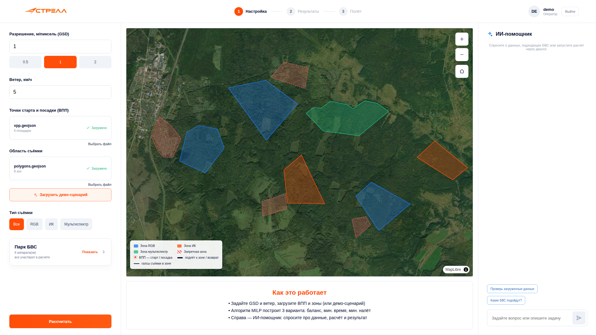
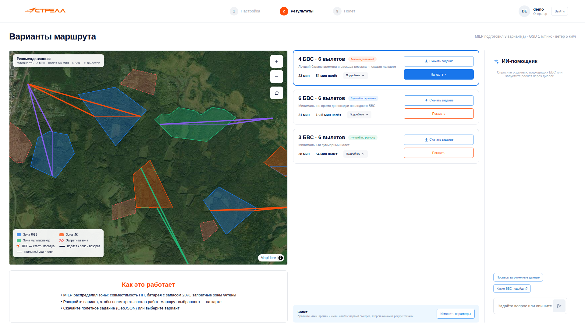
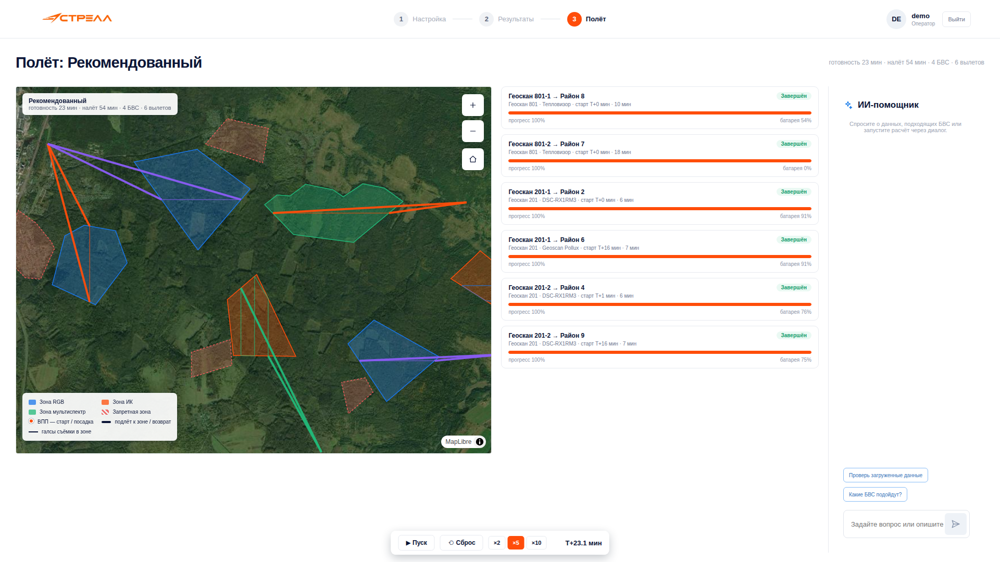

# GeoScan Planner — сервис планирования авиационных работ

Сервис планирования и распределения беспилотных авиационных работ (хакатон ЛЦТ 2026, кейс 15 «Геоскан Москва»). Принимает пространственные данные (зоны съёмки, запретные зоны, ВПП), распределяет одну съёмочную задачу между парком БВС алгоритмом **MILP (смешанно-целочисленное линейное программирование)**, строит маршруты и расписание вылетов, проверяет пространственные, энергетические и временные ограничения и экспортирует полётное задание в GeoJSON.

## Почему это конкурентное преимущество

**1. Математика вместо интуиции**  
Планирование вручную — это семь ограничений в голове одновременно: заряд с запасом 20%, ветер, запретные зоны, совместимость камеры, замена АКБ, безопасные сближения, достижимая посадка. Человек упрощает — получает субоптимальный план. MILP-оптимизатор перебирает все допустимые варианты и выдаёт доказуемо лучшее решение. На демо (6 зон, 6 дронов) — секунды.

**2. Три варианта — три бизнес-задачи**  
«Когда всё будет готово?» — 21 минута, 6 дронов. «Как сэкономить ресурс?» — 38 минут, 3 дрона. «Дайте баланс» — 23 минуты, 4 дрона. Все три считаются одновременно, на карте видно отличия. Заказчик выбирает, видя цифры.

**3. Честный отказ вместо опасного плана**  
Если ни один дрон не долетит — система не выдаст план «на честном слове». Скажет прямо: *«Зона 7 невыполнима: Геоскан 801 не долетит при ветре 30 км/ч (предел — 8 км/ч). Варианты: дождаться ветра, перенести ВПП или изменить зону»*. Каждый отказ — с причиной и советом.

**4. Всё видно на карте**  
Толстая линия — подлёт и возврат, тонкая — галсы съёмки, цвет — дрон, подпись — время работы. Клик по любому элементу → карточка: дрон, камера, высота, скорость, батарея, этап. Оператор за минуту объясняет заказчику, почему задача решена именно так.

**5. ИИ, который знает задачу**  
Встроенный Qwen 3.7 видит зоны, парк, ограничения, результат. Спрашиваете «почему для зоны 7 Геоскан 801?» — отвечает с цифрами: «только он с тепловизором; 18 минут работы, батарея уйдёт до 29% — в пределах запаса». Просите пересчитать — запускает расчёт и сравнивает варианты.

## Куда это можно вести дальше

**1. Пересчёт в воздухе**  
План статичен: ветер усилился — оператор решает сам. Развитие — метеоданные + пересчёт маршрута, пока дрон в полёте. Покрытие сохраняется, дрон получает коррекцию. Исчезает ситуация «дрон развернулся, потому что ветер, а нового плана нет».

**2. Расписание на день**  
Сейчас каждая миссия отдельно. В реальности — день из нескольких объектов, ограниченный парк, погодные окна. Расширение модели до VRP: кто летит, куда, когда, где перелёт, где замена батареи. MILP-модель — прямое продолжение.

**3. Прямая связь с дроном**  
Сейчас план экспортируется в GeoJSON, вручную загружается в QGroundControl. Дальше — MAVLink: «запустить» в интерфейсе → дрон летит по плану, система следит за телеметрией, предупреждает при отклонении. Цикл «план → полёт → отчёт» без ручных операций.

**4. Контроль качества до посадки**  
Проблему «снимки смазаны» находят в постобработке — через часы. Сопоставление телеметрии с расчётом в реальном времени → предупреждение «участок 3 нужно переснять» ещё до посадки. Меньше повторных вылетов.

**5. Командная работа**  
Сейчас инструмент одного оператора. В проекте — планировщик, руководитель, заказчик. Облачная версия с ролями: планировщик считает, руководитель утверждает, заказчик видит статус. Сервис превращается в рабочий инструмент компании.

**Статус (2026-09-29): реализовано и проверено.** Полный E2E-цикл проходит (`scripts/test_full_cycle.sh`): JWT-аутентификация → проект → загрузка демо-данных → MILP-расчёт в Celery → 3 варианта плана → проверка ограничений → экспорт GeoJSON → infeasible-сценарий с причинами.


## Архитектура

| Компонент | Стек | Порт |
|---|---|---|
| **UI** (frontend) | strela-prototype (vanilla JS) + MapLibre GL + Vite | **5175** (dev) / 80 (prod) |
| **backend** | Django 5.1, DRF, drf-spectacular (Swagger), PostGIS, simplejwt, Celery | 8000 |
| **worker** | Celery worker (Redis) | — |
| **mcp_server** | FastMCP, инструменты = httpx-обёртки REST API | 8001 |
| **db** | PostgreSQL 16 + PostGIS 3.4 | 5432 |
| **redis** | Redis 7 (брокер Celery) | 6379 |
| **nginx** (prod) | Reverse proxy + собранный фронтенд (multi-stage Dockerfile) | 80 |

Три эквивалентных способа работы с данными:
1. **REST API** — `/api/`, Swagger: `/api/docs/`;
2. **MCP** — `http://localhost:8001/mcp/` (prod: `/mcp/`), 8 инструментов, дублируют инструментарий приложения (для подключения сторонних ИИ-агентов);
3. **ИИ-агент** — `POST /api/chat/`, Qwen 3.7 Plus + function calling, тот же набор инструментов.

## Быстрый старт (dev)

```bash
cp .env.example .env
# LLM_API_KEY — только если нужен ИИ-агент (для демо, ключ нужно запросить у команды разработчика, либо получить самому, например, тут https://routerai.ru/settings/keys );
# .env в git не попадает, .env.example содержит только плейсхолдеры)
docker compose -f docker-compose.dev.yml up --build -d
bash scripts/test_full_cycle.sh   # E2E-проверка API (ALL CHECKS PASSED)
```

- **UI:** http://localhost:5175 — вход `demo` / `demo` (создаётся автоматически при старте backend; также есть superuser `admin` / `admin123`)
- **Swagger:** http://localhost:8000/api/docs/
- **MCP:** http://localhost:8001/mcp/

> Примечание: dev-фронтенд на 5175, потому что 5173 по умолчанию занят локальным vite прототипа (`strela-prototype/`).

Prod: `docker compose up --build -d` → http://localhost (nginx: фронтенд + `/api/` + `/mcp/` + `/static/`).

## Интерфейс (strela-prototype)

UI — исходный прототип СТРЕЛА (Figma-дизайн сохранён): тёмная спутниковая карта (Esri World Imagery) + светлые панели, 3 экрана «Настройка → Результаты → Полёт».

**Настройка**
- разрешение GSD (м/пикс, чипы 0.5 / 1 / 2), скорость ветра (км/ч);
- загрузка ВПП и области съёмки (GeoJSON-файл) **или** кнопка «Демо-сценарий»;
- тип съёмки: Все / RGB / ИК / Мультиспектр (фильтрует зоны);
- «Парк БВС» — реальные аппараты из ТТХ (модель, ПН, батарея), исключение из расчёта через меню `•••`;
- карта: зоны (цвет по типу съёмки + подписи названий), запретные зоны (пунктир), ВПП (оранжевые маркеры + подписи), легенда, зум;
- «Рассчитать» → задача уходит в Celery, фронт опрашивает статус.

**Результаты**
- 3 варианта: *Рекомендованный* (баланс), *Лучший по времени* (makespan), *Лучший по ресурсу* (суммарный налёт);
- у каждого: время до посадки последнего БВС, суммарный налёт, число БВС и вылетов, состав работ по зонам (тип · модель, время, вылеты);
- «Показать» — маршрут выбранного варианта на карте: цвет линий — по БВС, подпись «БВС · время работы» в центре зоны, инфо-панель с метриками (верхний левый угол);
- «Скачать задание» — GeoJSON-файл;
- **попапы по клику**: на зоне (тип съёмки, площадь, назначение БВС в выбранном варианте), на маршруте (вылет: БВС, зона, ПН, ВПП, старт, время, высота, скорость, батарея), на ВПП (какие вылеты из неё в выбранном варианте).

**Полёт (шаг 3)**
- симуляция выполнения выбранного плана: БВС движутся по маршрутам на карте в реальном времени;
- панель управления: «Пуск/Пауза», «Сброс», масштаб времени ×2 / ×5 / ×10, счётчик T+ (мин);
- карточки по каждому вылету: текущий этап (На ВПП → Подлёт → Съёмка → Возврат → Завершён), прогресс-бар, текущая батарея.

**ИИ-помощник** (правая панель, доступен на «Настройке» и «Результатах») — живой диалог с Qwen 3.7 Plus: вопросы о данных, парке, запуск расчёта, сравнение и объяснение вариантов через инструменты (function calling); ответы в Markdown (заголовки, списки, таблицы) рендерятся в панели (marked + DOMPurify), шрифт 13px.

## Алгоритм (MILP, pulp + CBC)

**Переменные:** `x[u,z] ∈ {0,1}` — БВС `u` выполняет зону `z` (один полигон = один вылет).

**Ограничения:**
- каждая зона — ровно одним БВС: `Σ_u x[u,z] = 1`;
- несовместимые пары исключены заранее: нет совместимой полезной нагрузки (thermal → только Геоскан 801; multispectral → Genimi/Геоскан 201; visible → все), ветер выше предела модели, коридор ВПП→зона пересекает запретную зону;
- **батарея (запас 20%)**: `подлёт + галсы + возврат ≤ 0.8 · time_fly · battery%` (FR-18);
- не более 2 вылетов на БВС, между вылетами 10 мин на замену АКБ (FR-11).

**Высота и галсы:**
- высота из целевого GSD и камеры: `H = GSD · 1000 · f / r` (H — м, r — мкм, f — мм); предельная высота `MAX_ALTITUDE_M = 3000` (для малоразмерных ПН, например тепловизора, GSD автоматически увеличивается до достижимого на предельной высоте — это задокументированное упрощение);
- шаг боковой = ширина кадра · (1 − перекрытие 50%, мин. по ТЗ), продольное перекрытие 60%;
- галсы — серпантин вдоль большей стороны зоны, **каждый галс обрезан по полигону (shapely-клиппинг): точка входа и выхода маршрута лежит точно на границе полигона**; время съёмки = длина (обрезанных) галсов + соединительные перелёты / скорость + развороты; для вогнутых полигонов сегменты галса соединяются прямыми перелётами (документированное упрощение);
- направление галсов относительно ветра — P2 (в MVP ветер: проверка выполнимости + фиксация в сценарии).

**Три варианта (MILP, CBC):**
1. *Рекомендованный* — `min (makespan + 0.15 · Σ налёт + 8 мин · число задействованных БВС)` — баланс: жертвует частью времени, чтобы задействовать меньше техники (отличается от обоих «чистых» критериев);
2. *Лучший по времени* — `min makespan` (время до посадки последнего БВС, FR-13);
3. *Лучший по ресурсу* — `min Σ налёт` (FR-14).

**Безопасность (FR-16…19):**
- запретные зоны: прямой коридор ВПП→зона не должен их пересекать (shapely, prepared geometry);
- посадка = ВПП вылета (каждый вылет завершается на площадке — из любой точки маршрута посадка достижима, FR-19);
- линейная модель энергии с безопасным остатком 20% (FR-18);
- дискретная проверка опасных сближений: порог 300 м, шаг 10 с, при конфликте — сдвиг времени старта (FR-17); пороги настраиваются в `settings.PLANNING`.

**Невыполнимость (FR-23/24):** при Infeasible сервис возвращает статус `infeasible` и конкретные причины по каждой зоне (нет ПН / батарея / запретная зона / ветер), а **не** неполный план как «успех».

## API

| Метод | Путь | Назначение |
|---|---|---|
| POST | `/api/auth/register/`, `/api/auth/login/`, `/api/auth/refresh/` | JWT (access + refresh) |
| GET | `/api/auth/me/` | Профиль пользователя |
| GET/POST | `/api/projects/` | Проекты (создание, список) |
| POST | `/api/projects/{id}/load_demo/` | Демо-сценарий (6 зон, 2 запрета, 6 ВПП) |
| POST | `/api/projects/{id}/load_data/` | Свои зоны/ВПП: `{"zones": FeatureCollection, "vpps": FeatureCollection}` |
| GET | `/api/projects/{id}/data/` | Текущие зоны и ВПП (FeatureCollection, для карты) |
| GET | `/api/projects/{id}/fleet/`, `/api/fleet/` | Парк БВС (`?active_ids=1,2`) |
| POST | `/api/projects/{id}/missions/` | Запуск расчёта (Celery): `{gsd, wind_kmh, side_overlap?, front_overlap?, active_uav_ids?, survey_types?}` → 202 + `{id}` |
| GET | `/api/missions/{id}/` | Статус/результат: `pending → running → success / infeasible / error` |
| GET | `/api/missions/{id}/export/` | Полётное задание (GeoJSON FeatureCollection) |
| POST | `/api/chat/` | ИИ-агент: `{message, history, project_id}` → `{response, map_data_list, actions}` |

**Словарь результатов.** Метрики варианта: `total_time_min` — время до посадки последнего БВС; `total_flight_min` — суммарный налёт; `uavs_used`, `sorties`. Полюс (sortie): `uav`, `model`, `zone`, `survey_type`, `payload`, `vpp`, `start_min` (минута от начала), `duration_min`, `t_transit_min`, `t_survey_min`, `altitude_m`, `speed_kmh`, `battery_used_pct` (доля от общего заряда, ≤ 80), `stages` (takeoff → transit_to_zone → survey → return → landing), `route` (координаты WGS84). Все времена — минуты, расстояния — км/м, высота — м над поверхностью.

**GeoJSON экспорта:** FeatureCollection: `kind=route` (LineString, свойства полюса), `kind=vpp` (Point), `kind=metadata` (сводка по вариантам).

**Формат входных зон (load_data):** GeoJSON FeatureCollection, `Polygon`/`MultiPolygon`, свойства: `name`, `kind` (`survey`/`forbidden`), `survey_type` (`visible`/`thermal`/`multispectral`). ВПП: `Point`, свойство `name`. WGS84 (EPSG:4326).

## ИИ-агент (Qwen 3.7 Plus + function calling)

- OpenAI-совместимый API (`LLM_API_BASE_URL/LLM_API_KEY/LLM_MODEL` в `.env`, по умолчанию routerai.ru / `qwen/qwen3.7-plus`);
- цикл tool-calling до 10 итераций, история последних 10 сообщений, системный промпт с правилами домена;
- 8 инструментов: `get_project_context`, `list_uavs`, `list_zones`, `start_planning` (синхронный расчёт + сохранение миссии), `get_planning_result`, `explain_plan`, `export_plan`, `get_map_data` (GeoJSON для карты);
- ответ: `{response, map_data_list, actions}` — `map_data_list` фронтенд рисует на карте, `actions` — след инструментов для прозрачности;
- без `LLM_API_KEY` чат отвечает понятной заглушкой (остальной сервис не зависит от ИИ).

Пример:
```bash
curl -X POST http://localhost:8000/api/chat/ \
  -H "Authorization: Bearer $TOKEN" -H 'Content-Type: application/json' \
  -d '{"message":"Запусти расчёт с GSD 1 и объясни назначения","history":[],"project_id":1}'
```

## MCP-сервер (FastMCP)

- transport: streamable-http, порт 8001 (prod: `/mcp/` через nginx с SSE-таймаутами);
- те же 8 инструментов, вызовы идут в REST API по httpx с заголовком `X-Internal-Token` (значение — `INTERNAL_API_TOKEN` в `.env`);
- для внешних агентов (Claude Desktop и т.п.): server URL `http://localhost:8001/mcp/`, header `X-Internal-Token`.

```json
{ "mcpServers": { "geoscan": { "url": "http://localhost:8001/mcp/",
  "headers": { "X-Internal-Token": "geoscan-internal-mcp-token" } } } }
```

## Демо-сценарий и типичный результат

Данные: 6 зон съёмки (3 visible, 2 thermal, 1 multispectral) + 2 запретные зоны, 6 ВПП, парк 6 БВС (2×Genimi, 2×Геоскан 801, 2×Геоскан 201) — `backend/geo_processing/data/`.

Типичный расчёт (GSD = 1 м/пикс, ветер 5 км/ч, E2E 2026-09-29):

| Вариант | Готовность | Налёт | БВС | Вылеты |
|---|---|---|---|---|
| Рекомендованный | 23.1 мин | 54.1 мин | 4 | 6 |
| Лучший по времени | 21.0 мин | 65.1 мин | 6 | 6 |
| Лучший по ресурсу | 38.2 мин | 54.1 мин | 3 | 6 |

Все вылеты ≤ 80% заряда; thermal-зоны выполняются только Геоскан 801 (единственный носитель тепловизора); зоны 6/6 покрыты; экспорт — 18 маршрутных Feature. Три варианта — три genuinely разных плана (4/6/3 БВС, разные назначения): на карте каждый вариант отличается цветами маршрутов, подписями «БВС · время старта» в зонах и инфо-панелью с метриками.

## Структура проекта

```
geoscan-planner/
├── backend/
│   ├── config/            # settings (PLANNING — все пороги алгоритма), urls, celery
│   ├── users/             # JWT: register/login/refresh/me
│   ├── survey/            # Project, SurveyZone, VPP, Mission; views, tasks (Celery)
│   └── geo_processing/    # ЯДРО:
│       ├── gals.py        #   высота из GSD, размеры кадра, серпантин галсов
│       ├── milp.py        #   MILP-модель (pulp/CBC), 3 целевые функции
│       ├── checks.py      #   запретные зоны, дискретные сближения
│       ├── planning.py    #   оркестратор: пары → MILP → расписание → варианты
│       ├── export.py      #   GeoJSON экспорта
│       ├── chat_handler.py#   Qwen-агент + 8 инструментов
│       ├── _local_test.py #   быстрый тест ядра без БД (в контейнере)
│       └── data/          # polygons/vpp .geojson, ttx_uav/payload .json, fleet.json
├── mcp_server/            # FastMCP, 8 инструментов (httpx → REST)
├── frontend/              # strela-prototype (index.html, prototype.js, prototype.css) + MapLibre
├── db/                    # postgis/postgis:16-3.4 + init SQL
├── nginx/                 # prod: multi-stage (сборка фронта + reverse proxy)
├── scripts/test_full_cycle.sh
├── docker-compose.dev.yml / docker-compose.yml
└── .env.example / .env    # .env не коммитится
```

## Настройка

`.env`: `LLM_API_BASE_URL/LLM_API_KEY/LLM_MODEL` (Qwen через OpenAI-совместимый API), `INTERNAL_API_TOKEN` (MCP → backend), параметры БД/Redis.

Все пороги алгоритма — `backend/config/settings.py → PLANNING`: `ENERGY_RESERVE` (0.2), `MAX_SORTIES_PER_UAV` (2), `RECHARGE_MIN` (10), `SIDE_OVERLAP` (0.5), `FRONT_OVERLAP` (0.6), `TURN_TIME_S` (8), `CLIMB_TIME_MIN` (2), `ROUTE_CORRIDOR_FACTOR` (1.15), `MAX_ALTITUDE_M` (3000), `MIN_SEPARATION_M` (300), `CONFLICT_TIME_STEP_S` (10).

## Проверка

- `scripts/test_full_cycle.sh`: register → login (JWT) → проект → load_demo → расчёт (Celery) → проверки (**батарея ≤ 80%**, **thermal → только Геоскан 801**, **покрытие 6/6 зон**) → экспорт GeoJSON (валидность + 18 маршрутов) → infeasible (ветер 30 км/ч → причины по зонам) → OpenAPI schema. Итог: `ALL CHECKS PASSED`.
- `docker compose exec backend env DJANGO_SETTINGS_MODULE=config.settings python geo_processing/_local_test.py` — ядро MILP без БД (пары БВС-зоны, 3 варианта, проверки).
- Swagger: `/api/docs/`.

## Известные упрощения (документированы в ТЗ)

- маршруты — прямолинейные сегменты (коридор с коэффициентом 1.15); рельеф не учитывается (поддержание высоты — функция автопилота, FR-20);
- посадка = взлётная ВПП (FR-19 тривиально выполнима);
- сближения — дискретная проверка по порогам сценария (`settings.PLANNING`), численные пороги заказчиком не заданы (FR-17);
- направление галсов фиксировано (ветер — проверка выполнимости; детальное влияние — P2);
- один полигон = один вылет (FR-07 «разбиение» — через несколько зон/вылетов);
- GSD ниже достижимого для камеры на допустимой высоте автоматически повышается до предельной высоты (для тепловизора/мультиспектра).

## Скриншоты

| Настройка (демо-данные, карта Esri World Imagery) | Результаты (3 варианта, маршруты и подписи на карте) | Полёт (симуляция выполнения плана) |
|---|---|---|
|  |  |  |

## Заметки для разработки (грабли, уже обойдены)

- **openai 1.65.2 + httpx 0.28.1** — openai 1.51 падает с `Client.__init__() got an unexpected keyword argument 'proxies'`;
- **django.contrib.gis (GEOS)**: у `MultiPolygon` нет `.bounds` / `.as_xyjson` / `.polygons` — кольца берутся через WKT + `shapely.get_parts`;
- **django.contrib.admin исключён** из `INSTALLED_APPS`: в собранном docker-образе Django собирался с повреждённым пакетом (нет `admin/urls.py`); admin не нужен для MVP;
- **формула высоты** `H = GSD·1000·f/r` — без `Ly` (вариант с `Ly` давал 10–30 км);
- **MapLibre**: карта создаётся только при прикреплённом контейнере (иначе canvas ~300px); литеральные массивы в style-выражениях — `["literal", [...]]`; `text-field` требует `glyphs` в style; `setData` до `on("load")` — данные теряются (очередь pending); `addLayer(spec, beforeId)` — beforeId должен указывать на уже существующий слой (иначе слой молча не добавляется, console error);
- **кэширование CSS в dev**: в `index.html` стили и JS подключены с версией (`?v=N`) — при изменении `prototype.css`/`prototype.js` версию в `index.html` нужно повышать, иначе браузер отдаёт старый кэш (симптом: «элемент пропал после перезагрузки страницы»);
- **worker не подхватывает правки** `geo_processing/` без рестарта: `docker compose -f docker-compose.dev.yml restart worker`;
- порт 5173 занят локальным vite `strela-prototype/` — dev-фронтенд на **5175**;
- после пересоздания БД (volume) — миграции и demo-пользователь восстанавливаются командой backend автоматически.
